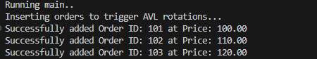

# High-Frequency Trading (HFT) Limit Order Book (LOB)

A high-performance, low-latency Limit Order Book implemented in C, based on the architectural principles defined by **WK Selph**. This implementation extends the original concept with modern high-frequency trading optimizations.

## 🚀 Key Features & Performance
* **Time Complexity:** * **Add Order:** $O(\log M)$ for new price levels, $O(1)$ for existing levels.
    * **Cancel/Execute:** $O(1)$ via hash-mapped order lookups.
    * **Best Bid/Offer:** $O(1)$ via tracked leaf pointers.
* **AVL Balancing:** Uses tree rotations to ensure $O(\log M)$ worst-case search latency, preventing "tree-drift" during volatile market conditions.
* **Hardware Affinity:** Designed for "Silo" parallelism, allowing ticker-specific pinning to dedicated CPU cores to avoid mutex contention.
* **Hybrid Architecture:** C-engine performance wrapped in a Python/Flask Microservice for real-time web-based monitoring.

## Results
  



## 🏗️ Architecture
Following the WK Selph methodology, this LOB utilizes a nested data structure:
1.  **The Book:** Maintains two separate AVL trees for Bids and Asks.
2.  **Limit Levels:** Each node in the tree represents a price level, containing a doubly-linked list of orders (FIFO priority).
3.  **The Map:** A hash table provides $O(1)$ access to any `OrderID`, bypassing the tree for cancellations and replacements.


## 🛠️ Tech Stack
* **Core:** C (C11)
* **Build System:** CMake
* **Integration:** `ctypes` for Python-C binding
* **Frontend/API:** Flask (Microservice Layer)

## 🏁 Getting Started

### Prerequisites
* CMake 3.10+
* MSVC (Windows) or GCC (Linux)
* Python 3.x (for Flask API)

### Build Instructions
```bash
mkdir build && cd build
cmake ..
cmake --build .

```

### Running Tests

Execute the engine with the `--test` flag to run the CuTest Suite:

```bash
./HFT_Orderbook --test

```

## Further Improvements

Hardware Cache Tiering, Lock-Free "Silo" Parallelism

## 📖 Background & References

This project is an implementation of the logic described by WK Selph in the seminal blog post:
*"How to build a fast limit order book"*

* **Original Post:** [HowToHFT Blog](http://howtohft.wordpress.com/2011/02/15/how-to-build-a-fast-limit-order-book/)
* **Archive:** [WayBack Machine](https://goo.gl/KF1SRm)

---

*Developed for educational exploration of low-latency systems and financial engineering.*


---

